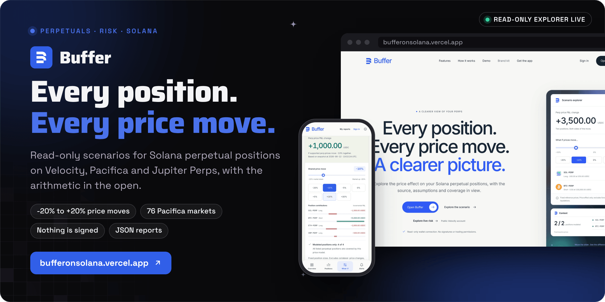
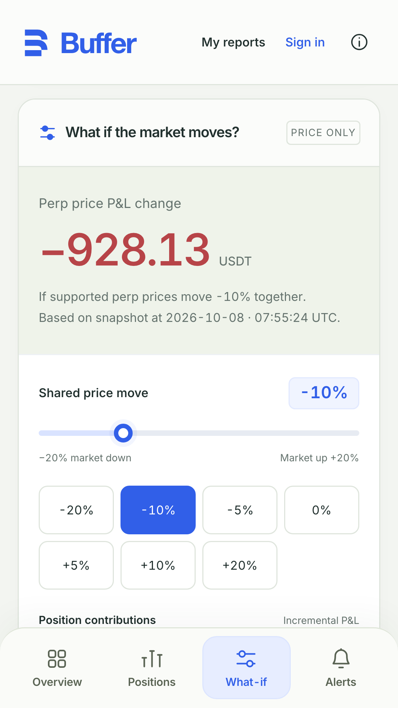
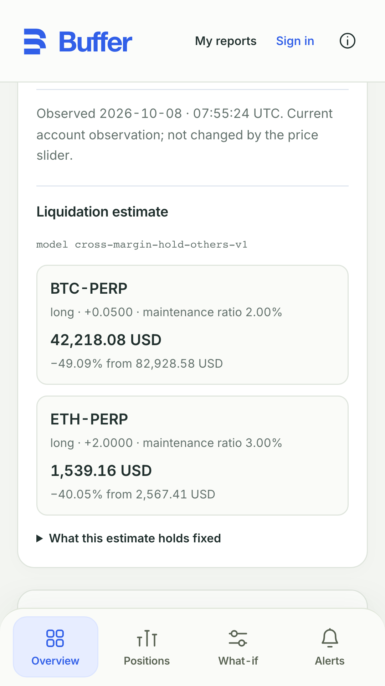
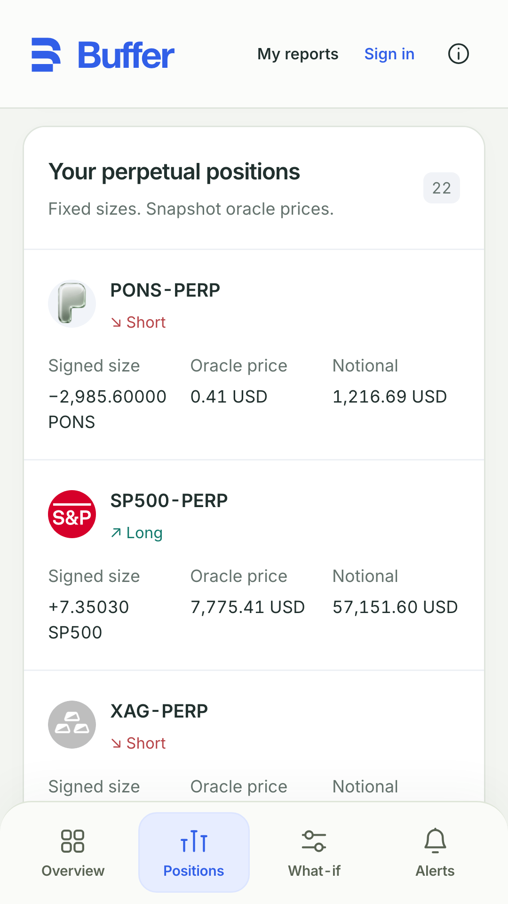

<div align="center">



<br><br>

<a href="https://bufferonsolana.vercel.app/app"></a>&nbsp;&nbsp;
<a href="https://bufferonsolana.vercel.app/demo"></a>&nbsp;&nbsp;
<a href="docs/RISK-CONTEXT.md"></a>

<br><br>

<a href="https://github.com/operatoruplift/buffer/actions/workflows/ci.yml"></a>
<a href="https://bufferonsolana.vercel.app"></a>


<a href="LICENSE"></a>

<h3>Explore the price effect on your Solana perpetual positions, with the source, assumptions and coverage in view.</h3>

<b>Choose</b> &nbsp;→&nbsp; <b>Read</b> &nbsp;→&nbsp; <b>Move prices</b> &nbsp;→&nbsp; <b>Explain</b> &nbsp;→&nbsp; <b>Report</b>

<br>

<a href="#how-it-works">How it works</a> &nbsp;·&nbsp;
<a href="#providers">Providers</a> &nbsp;·&nbsp;
<a href="#status">Status</a> &nbsp;·&nbsp;
<a href="#run-it-locally">Run it locally</a> &nbsp;·&nbsp;
<a href="#documentation">Docs</a>

</div>

<br>

<picture>
  <source media="(prefers-color-scheme: dark)" srcset="docs/readme/screens-dark.png">
  
</picture>

<p align="center"><sub>Captured from a local production build on 30 October 2026, using the app's built-in sample portfolio and fixed reference snapshot. No live account was read.</sub></p>

**Buffer shows what a market move would do to your perpetual positions on Solana.** Paste a public address or connect a wallet to fill one in, read a Velocity or Pacifica account, and explore one shared price move from -20% to +20% with the arithmetic in the open. Jupiter Perps adds a position inventory with its modeling scope stated, and legacy Drift stays a clearly labeled historical read because that deployment is paused. Buffer explains exposure and never trades or signs.

Built by Matt ([RVAClassic](https://x.com/rvaclassic), [Operator Uplift](https://operatoruplift.com)) for the Solana Foundation **Perps & Prediction Markets** sprint, September 2026.

<br>

## How it works

<picture>
  <source media="(prefers-color-scheme: dark)" srcset="docs/readme/flow-dark.png">
  
</picture>

<table>
  <tr valign="top">
    <td width="33%"><b>Simple math, carefully scoped</b><br><sub>Incremental price P&amp;L is signed quantity × frozen oracle price × move. Sizes stay fixed, and collateral-price changes, future fills, funding, fees, borrowing interest and liquidation effects stay outside the model.</sub></td>
    <td width="33%"><b>Unavailable, never guessed</b><br><sub>Any metric Buffer cannot source from the provider is labeled <b>Unavailable</b> with the reason, so a missing oracle price or an isolated position stays visible instead of being filled in. A failed refresh keeps the old snapshot on screen, labeled stale, and stops calculating on it.</sub></td>
    <td width="33%"><b>Useful without an account</b><br><sub>Samples, public reads and device-saved reports need no sign-in or wallet. Connecting a wallet only fills in its public address; Buffer carries no transaction or trading path.</sub></td>
  </tr>
</table>

For signed base quantity `q`, frozen external oracle price `p` and shock fraction `s`:

```text
Incremental price P&L = q × p × s
Hypothetical price   = p × (1 + s)
Position notional    = abs(q × p)
```

The default editable portfolio starts with 100 SOL long at 150, 0.5 BTC short at 100,000, 8 ETH long at 2,500 and 2,500 XRP long at 2. At -10%, the contributions are -1,500, +5,000, -2,000 and -500 USDC, for a combined **+1,000 USDC**. The preserved Long + short fixture keeps the smaller two-position example: -1,500 USDC plus +5,000 USDC equals **+3,500 USDC**. Zero shock produces zero. This result is incremental perpetual price P&amp;L, not hypothetical account equity or health.

<details>
<summary><b>Arithmetic and boundaries, in full</b></summary>
<br>

USDC, USDT and USD in the sample builder are illustrative labels only; changing the denomination keeps the numeric inputs and performs no FX conversion. Live Velocity positions stay settled in verified USDT, while the SDK's net-value and funding-inclusive P&amp;L baselines are converted and labeled USD. Pacifica API price effects are labeled USD and create no invented USDC pairs. Decimal strings preserve precision; rounding happens only for presentation. Verified quote currencies keep separate totals.

The scenario holds sizes fixed and excludes collateral-price changes, future fills, funding, fees, borrowing interest and liquidation effects. Spot deposits, debts and order counts stay visible. Unsupported or nonlinear contracts, LP exposure, unknown flags, inactive markets and invalid oracle prices receive explicit exclusions.

A separate estimate (model `cross-margin-hold-others-v1`, live Velocity reads only) solves, one position at a time, the oracle price at which that position alone would bring maintenance collateral down to the maintenance requirement, holding every other price, funding, fee and open order where the provider observed them. The card lists those assumptions and each exclusion. See [current risk context and model limits](docs/RISK-CONTEXT.md).

Velocity perps use the SDK's applicable oracle validity helper plus Buffer's **150-slot maximum lag**. Spot valuation also checks protocol margin staleness, volatility, sufficient data and a **1% confidence cap**. Pacifica uses its API's USD oracle prices with a **120-second price-age limit** and explicit API provenance; these are not independently verified Solana oracle reads. USDC margin balances stay distinct from USD scenario totals, with no assumed peg conversion. Live snapshots expire at most **120 seconds after retrieval**, or earlier when the source price expires. Reads are not atomic. SDK baseline valuation may use a separately validated MM oracle, and cross-margin health is reported only where it describes the positions, so isolated positions never borrow a cross-margin number.

</details>

<details>
<summary><b>Using the explorer</b></summary>
<br>

1. Choose among **12 fixed scenarios** or the editable **four-market portfolio**. For public reads, select **Velocity** (the default), **Pacifica** or **Jupiter Perps**, use **Explore a live account** or enter a public wallet address, and select the discovered account. With Velocity selected, the **Network** switch reads Velocity's devnet deployment instead (`&network=devnet` in links), and **Explore a devnet account** opens a public devnet subaccount holding SOL, ETH and BTC perps. Devnet balances are test values, and background monitoring stays on mainnet. In samples, **Add perps** searches all 76 configured sample identities, with editable direction, quantity and baseline price. Accounts are never combined.
2. Inspect the frozen baseline, positions and inventory.
3. For modeled samples, Velocity and Pacifica, move the slider, choose a preset or use the arrow keys in 1% steps. **Reset** returns to zero. A successful live **Refresh** reloads the snapshot and resets the move; a sample refresh keeps edited positions and resets only the move. Jupiter inventory and legacy Drift stay inventory and history, so neither produces a modeled price effect.
4. Open **Method** for assumptions, exclusions, addresses, source, and RPC slots or API price timestamps. **Download report** saves precise JSON locally, including edited sample positions and prices.
5. Open **My reports** to save the current report on this device with no sign-up (up to 20). With a confirmed cloud account, the same screen also saves, downloads and deletes private cloud copies (up to 50 reports and 8 MiB per account). Saved copies are historical records and never refresh with the market.

Public exploration does not upload a report. Device storage happens only when a visitor selects **Save current scenario**, and cloud storage only when a signed-in user selects it. Supabase row-level security limits cloud records to their owner, and a signed-in user can delete their account and its data.

The landing page and the app also offer **Explore live risk**: a validated public Velocity account link with fresh reads, automatic selection when exactly one subaccount is discovered and a deliberate choice when there are several. Current maintenance context sits beside the independent price scenario.

</details>

<p align="center"><sub>Next.js 16 · React 19 · TypeScript · Velocity SDK 0.23.1 · @solana/web3.js · decimal.js · Supabase · Wallet Standard and Mobile Wallet Adapter · Vitest · Playwright · PWA · Android Web Shell</sub></p>

<br>

## Providers

<table>
  <tr>
    <th width="18%" align="left">Provider</th>
    <th width="44%" align="left">What Buffer reads</th>
    <th width="38%" align="left">How it is modeled</th>
  </tr>
  <tr valign="top">
    <td><b>Velocity</b><br><sub>default</sub></td>
    <td>Account discovery, explicit subaccount selection, positions, collateral, debt and orders through the official <code>@velocity-exchange/sdk</code> 0.23.1, across its four SOL, BTC, ETH and HYPE markets, on mainnet or devnet.</td>
    <td>USDT price scenarios, cross-margin maintenance context, and the per-position liquidation estimate. See <a href="docs/PROVIDER.md">live protocol providers</a>.</td>
  </tr>
  <tr valign="top">
    <td><b>Pacifica</b></td>
    <td>Public accounts and positions through its fixed official REST API, with no API key or RPC. All 76 configured perpetual identities, across crypto, equities, commodities, FX and indexes, are checked against current market metadata.</td>
    <td>USD price effects from API oracle prices with their timestamps. See <a href="docs/PACIFICA.md">Pacifica integration</a>.</td>
  </tr>
  <tr valign="top">
    <td><b>Jupiter Perps</b></td>
    <td>Canonical SOL, ETH and BTC position identities: direction, USD size, entry price, recorded collateral, reserved collateral-token amounts, and source accounts and read slots.</td>
    <td>Inventory only. An honest scenario needs the current oracle contract, collateral dependencies and the maximum-profit cap modeled together, so these rows stay out of totals. See <a href="docs/JUPITER-VERIFICATION.md">Jupiter verification</a>.</td>
  </tr>
  <tr valign="top">
    <td><b>Legacy Drift</b></td>
    <td>Historical reads of the paused deployment, whose balances do not migrate to Velocity.</td>
    <td>History only, linked to the official migration reference and never mixed with Velocity prices.</td>
  </tr>
</table>

Market counts describe provider listings, not unique assets across exchanges. Every live load refetches its source and exposes the relevant API timestamps or account and read slots; recorded live observations are point-in-time, not fixed balances. The [provider coverage matrix](docs/PROVIDER-COVERAGE.md) separates implemented behavior, live evidence and remaining external requirements.

<table>
  <tr valign="top">
    <td width="33%" align="center"><br><sub><b>A live price scenario</b> on a public Velocity account</sub></td>
    <td width="33%" align="center"><br><sub><b>The liquidation estimate</b>, one position at a time</sub></td>
    <td width="33%" align="center"><br><sub><b>Pacifica positions</b> across crypto, indexes and metals</sub></td>
  </tr>
</table>

<p align="center"><sub>From the repository's dApp Store listing kit in <a href="docs/dapp-store/listing.md">docs/dapp-store</a>, which <code>scripts/generate-dapp-store-assets.mjs</code> captures from the live site. Observations dated 8 October 2026; public account contents change.</sub></p>

<br>

## Status

<table>
  <tr valign="top">
    <td width="16%" align="center"></td>
    <td>The website and explorer at <a href="https://bufferonsolana.vercel.app">bufferonsolana.vercel.app</a>: samples, public Velocity and Pacifica reads, Jupiter inventory, device reports, the films, the brand kit and the installable PWA. On 30 September 2026, fresh public provider probes returned two Velocity positions in USDT and 22 Pacifica positions in USD.</td>
    <td width="22%"><a href="docs/BUFFER-INTEGRATION-STATUS.md">Integration status</a></td>
  </tr>
  <tr valign="top">
    <td align="center"></td>
    <td>Hosted monitoring of maintenance headroom and of the liquidation distance of one position per rule. A read-only production check on 1 October 2026 found 30 successful cron runs and 30 completed protected worker runs in the preceding 30 minutes, all in <code>dry_run</code> mode. Discord and signed-webhook delivery are implemented, but outbound delivery is not yet verified and no recipient receipt is claimed.</td>
    <td><a href="docs/ALERTS.md">Alerts runbook</a></td>
  </tr>
  <tr valign="top">
    <td align="center"></td>
    <td>Public self-service signup and password recovery. Cloud sign-in is open to confirmed accounts; signup and recovery come with a deployment that configures production SMTP, exact Auth redirect URLs and a server-side password policy, then sets <code>NEXT_PUBLIC_AUTH_EMAIL_READY=true</code>. Production keeps it <code>false</code>.</td>
    <td><a href="docs/DEPLOYMENT.md">Deployment</a></td>
  </tr>
  <tr valign="top">
    <td align="center"></td>
    <td>The Seeker Android Web Shell (<code>com.operatoruplift.buffer</code>, wrapping <code>/app</code>) with one-tap address fill through Mobile Wallet Adapter, plus the dApp Store listing kit. Web checks do not establish a signed APK release or device compatibility; the on-device steps still need a phone.</td>
    <td><a href="docs/seeker-and-pwa.md">Seeker and PWA</a></td>
  </tr>
  <tr valign="top">
    <td align="center"></td>
    <td>Built for the Solana Foundation Perps &amp; Prediction Markets sprint. The <a href="https://hackathons.solana.com/hackathons/perps-and-prediction-markets">official event page</a>, checked 11 September 2026, listed 18 to 25 September 2026. The organizers are the authority on eligibility; the submission draft is marked not submitted, and this README claims no submission or acceptance.</td>
    <td><a href="docs/SUBMISSION.md">Submission draft</a></td>
  </tr>
</table>

<br>

## Run it locally

<table>
  <tr valign="top">
    <td width="33%"><b>Prerequisites</b><br><sub>Node 24: <code>.nvmrc</code> pins 24.16.0 and <code>package.json</code> accepts 24.x (the verified deployment used 24.19.0). npm 11, as in CI. No RPC or account is needed for the samples or Pacifica.</sub></td>
    <td width="33%"><b>Read first</b><br><sub><a href="docs/RISK-CONTEXT.md">Risk context and model limits</a>, and <a href="docs/DEPLOYMENT.md">deployment and cloud configuration</a> before switching on accounts or monitoring.</sub></td>
    <td width="33%"><b>What the checks prove</b><br><sub>Most live UI cases mock API responses so the suite stays deterministic. Live evidence is recorded separately in <a href="docs/PROVIDER-COVERAGE.md">provider coverage</a> and the <a href="docs/BUFFER-INTEGRATION-STATUS.md">integration status</a>.</sub></td>
  </tr>
</table>

### 1. Run the app

```bash
nvm install && nvm use             # Node 24.16.0 from .nvmrc
npm ci
cp .env.example .env.local         # optional: samples and Pacifica need no configuration
npm run dev -- --port 3001         # http://127.0.0.1:3001, and the explorer is at /app
```

### 2. Before a pull request, run what [CI](.github/workflows/ci.yml) runs

```bash
npm run lint
npm run typecheck
npm test
npm run build
npx playwright install chromium
npm run test:e2e                   # launches or reuses a server on port 3001
```

CI also verifies the migrations, owner isolation, account deletion and rate limits against a local PGlite database, with no external writes:

```bash
npm install --prefix /tmp/buffer-pglite --no-package-lock @electric-sql/pglite@0.5.8
export BUFFER_PGLITE_MODULE=/tmp/buffer-pglite/node_modules/@electric-sql/pglite/dist/index.js
node scripts/verify-alert-schema.mjs
node scripts/verify-hosted-monitoring.mjs
node scripts/verify-monitoring-scheduler.mjs
node scripts/verify-account-deletion.mjs
node scripts/verify-rate-limit.mjs
node scripts/verify-saved-report-quota.mjs
```

Set `PLAYWRIGHT_BASE_URL` to exercise an already running deployment. Point `BUFFER_AUTH_FIXTURES` at a private JSON array of two disposable confirmed accounts (`email` and `password`) to include the real Auth suite's desktop and mobile cases; every other case runs without it. Never commit fixture credentials. `npm run alert:worker -- --fixture` runs the local durable mock worker, which has no external delivery.

### 3. Configuration

| Variable | Purpose |
|---|---|
| `SOLANA_RPC_URL` | Server-only Solana mainnet RPC for Velocity, Jupiter inventory and legacy Drift. It must support `getGenesisHash`, filtered `getProgramAccounts`, `getAccountInfo`, `getMultipleAccounts` and `getSlot`. Never expose it through a `NEXT_PUBLIC_` variable. |
| `SOLANA_DEVNET_RPC_URL` | Optional server-only devnet RPC for Velocity devnet reads; without it, Solana's public `https://api.devnet.solana.com`. |
| `BUFFER_TEST_AUTHORITY` | Optional public authority with active Velocity positions, for manual verification; the app does not load it. |
| `NEXT_PUBLIC_SUPABASE_URL`, `NEXT_PUBLIC_SUPABASE_PUBLISHABLE_KEY` | Optional dedicated Supabase project and its public key, never a service-role key. Embedded at build time, so rebuild after changing them. |
| `NEXT_PUBLIC_AUTH_EMAIL_READY` | `true` only on a deployment whose email confirmation and recovery are configured and checked end to end. The `false` default keeps sign-in plus the no-account paths. |
| `NEXT_PUBLIC_SUPPORT_EMAIL` | Optional support address on `/privacy` and `/terms`; unset points to this repository's issues. |
| `RATE_LIMIT_SECRET` | Optional server-only secret for the distributed read limit (needs the protected `consume_rate_limit` RPC). Unset or unreachable means per-process limits only. |
| `BUFFER_ALERT_STORE` | Path for the local SQLite mock worker; defaults to `.local/alerts.sqlite`. |
| `BUFFER_ALERT_WORKER_SECRET`, `CRON_SECRET` | Hosted monitoring credentials, separate from browser auth. Store only the SHA-256 of the worker secret in `private.buffer_monitor_credentials`. |
| `BUFFER_ALERT_SEND_ENABLED`, `BUFFER_ALERT_NOTIFICATION_MODE` | Delivery switches, `false` and `test` by default. |
| `BUFFER_DISCORD_DESTINATIONS_JSON`, `BUFFER_WEBHOOK_DESTINATIONS_JSON` | Server-admin destinations with owner allowlists. See [Discord alerts](docs/DISCORD-ALERTS.md) and [signed webhook alerts](docs/WEBHOOK-ALERTS.md). |
| `SUPABASE_ACCESS_TOKEN`, `SMTP_HOST`, `SMTP_PORT`, `SMTP_USER`, `SMTP_PASS`, `SMTP_SENDER_EMAIL` | Setup-only credentials shown in `.env.example`; the application never reads them. |

No wallet private key, application AI key or service-role key is needed by the application.

<details>
<summary><b>Deploy</b></summary>
<br>

Vercel uses the explicit Next.js framework setting in `vercel.json` and Node route execution. The account and snapshot routes allow 30 seconds, as do most monitoring routes; the monitoring check and worker routes allow 60. The dedicated Supabase project, saved-report migrations and owner-scoped alert tables are deployed; the protected worker and Discord adapter activate through their own scheduler credential and recipient verification. The server RPC must be a Solana mainnet endpoint, and a dedicated endpoint is needed for sustained production capacity. Follow [deployment](docs/DEPLOYMENT.md) for cloud configuration and email setup, [database verification](docs/DATABASE-VERIFICATION.md) for ownership checks, and [PWA documentation](docs/PWA.md) for the per-browser install paths. Recorded activation evidence is in the [integration status](docs/BUFFER-INTEGRATION-STATUS.md).

</details>

<details>
<summary><b>Limits, freshness and safety</b></summary>
<br>

RPC requests have an 18-second total abort deadline, an 8 MiB decoded response bound and request-owned loaders without polling timers. Pacifica has its own 18-second, 1 MiB fixed-origin boundary. Reads reject redirects and use no-store. Live reads go through a budget: identical requests within five seconds share one provider call, each client may make 30 reads a minute (counted across instances when the shared store is configured), and each instance allows 240 reads a minute with 8 in flight. Provider errors are sanitized and never silently replaced by samples. Generation checks stop late account, subaccount or previous-user responses from replacing current state. Auth writes and SDK storage commits are bound to the initiating user and session, and uncertain cloud writes require reloading the library before a retry.

Hosted monitoring runs on a protected worker with its own server-only credential and scheduler secret. Discord delivery is available on a deployment that registers an owner-scoped destination, verifies that destination's channel and holds recipient authorization; every send reverifies the destination first, and a Discord notification counts as delivered only once a matching message receipt comes back. [Signed webhook destinations](docs/WEBHOOK-ALERTS.md) POST an HMAC-SHA256-signed JSON payload to a server-configured HTTPS URL and count a 2xx acknowledgement as the receipt. Example alerts are an isolated local rehearsal.

The PWA caches only its explicit public offline assets; API responses, Supabase requests, auth, saved reports and live page data bypass that cache.

</details>

<details>
<summary><b>Architecture and source map</b></summary>
<br>

```text
Website / demo gallery                    Optional email/password sign-in
            │                                           │
            ▼                                           ▼
/app: public explorer                         Supabase Auth session
   ├─ deterministic samples                           │
   └─ /api/accounts → explicit subaccount              ▼
      /api/snapshot → Velocity (default),      saved_reports + owner RLS
                      Pacifica, legacy Drift  ▲  save / download / delete
                      Jupiter (inventory only)
                      │
              RPC or public API validation
                      ▼                              │
              decimal-string Snapshot               │
                      ▼                              │
              pure scenario calculation → JSON report

PWA service worker → public offline sample and icon allowlist only
```

| Area | Source |
|---|---|
| Website, explorer, account screen, videos | `src/app/{page,app/page,auth/page,demo/page}.tsx` |
| Interactive UI | `src/components/Landing.tsx`, `Dashboard.tsx`, `SampleBuilder.tsx`, `AccountPanel.tsx`, `AuthForm.tsx`, `Brand.tsx`, `TokenIcon.tsx` |
| Provider selection and request validation and limits | `src/server/providers.ts`, `src/server/boundary.ts`, `src/server/live-read-budget.ts` |
| Velocity acquisition, coverage and normalization | `src/server/velocity.ts`, `src/server/velocity-normalize.ts` |
| Pacifica public API acquisition and normalization | `src/server/pacifica.ts`, `src/server/pacifica-normalize.ts` |
| Jupiter inventory decoding, validation and acquisition | `src/server/jupiter-decoder.ts`, `jupiter-normalize.ts`, `jupiter.ts`, `jupiter-provider.ts` |
| Legacy Drift compatibility | `src/server/drift.ts`, `src/server/normalize.ts` |
| Types, scenario math, fixtures, editable sample portfolio, reports | `src/lib/`, especially `sample-builder.ts`, `report.ts` and `device-reports.ts` |
| Private report, alert and monitoring schema and policies | `supabase/migrations/` |
| Installation and offline sample | `src/app/manifest.ts`, `src/components/PwaClient.tsx`, `public/sw.js`, `public/offline.html` |
| Seeker Android shell | `android/` |

Direct dependency versions and the lockfile are pinned: Next.js 16.4.3, React 19.3.0, TypeScript 5.9.3, Velocity SDK 0.23.1 with its web3.js 1.99.0 alias, legacy Drift SDK 2.161.0-beta.5, spl-token 0.4.13, decimal.js 10.6.0 and Supabase JS 2.116.0. Captured public State, perp, spot and oracle buffers guard both the current Velocity decoder and the legacy Drift compatibility path.

</details>

<details>
<summary><b>Brand, films and design</b></summary>
<br>

Buffer's ribbon B monogram, wordmark, favicon, transparent PNG and monochrome variants live in `public/brand/`, and install icons in `public/icons/`. The primary browser icon is the blue install tile at `/icons/icon.svg?v=tile4`; `public/favicon.ico` keeps the 192×192 PNG fallback. The shared `Brand` component uses the cobalt mark and Helvetica or Arial at weight 550 across the landing header, app, demo, auth screen and footer. Verified token marks live in `public/tokens/`, and the shared `TokenIcon` component reuses those local originals for market rows and the sample builder. The UI and media keep product identity apart from descriptive protocol names and sample data.

The [brand collection](https://bufferonsolana.vercel.app/brand-kit) holds 15 individually composed images: profile images, phone and 4K desktop wallpapers, X, LinkedIn and YouTube headers, social posts, a story and clean backgrounds. Daylight glass and midnight cobalt artwork share the exact ribbon mark. Full-image previews, category filters, mobile original-image links and a complete ZIP make the assets usable from a phone. [Art direction, source prompts and the local export pipeline](design/brand-kit/README.md) are included; the site needs no runtime image service.

The [demo page](https://bufferonsolana.vercel.app/demo) opens with the [launch film](docs/LAUNCH-FILM.md), followed by the product, pitch and technical films with conversational narration, captions, transcripts and 1080p downloads. [Video provenance](docs/VIDEO.md) identifies captured mainnet observations, illustrative inputs and the synthetic voice.

</details>

<br>

## Documentation

<table>
  <tr valign="top">
    <td width="33%"><b>Understand it</b><br><sub><a href="docs/DESCRIPTION.md">Short and full descriptions</a><br><a href="docs/RISK-CONTEXT.md">Risk context and model limits</a><br><a href="docs/PROVIDER-COVERAGE.md">Provider coverage</a><br><a href="docs/PROVIDER.md">Live protocol providers</a>, <a href="docs/PACIFICA.md">Pacifica</a> and <a href="docs/JUPITER-VERIFICATION.md">Jupiter</a></sub></td>
    <td width="33%"><b>Operate it</b><br><sub><a href="docs/DEPLOYMENT.md">Deployment and cloud configuration</a><br><a href="docs/DATABASE-VERIFICATION.md">Database verification</a><br><a href="docs/ALERTS.md">Threshold monitoring runbook</a><br><a href="docs/DISCORD-ALERTS.md">Discord</a> and <a href="docs/WEBHOOK-ALERTS.md">signed webhook</a> alerts</sub></td>
    <td width="33%"><b>Check it</b><br><sub><a href="docs/BUFFER-INTEGRATION-STATUS.md">Integration status</a><br><a href="docs/REDESIGN-VERIFICATION.md">Current verification</a><br><a href="docs/RELIABILITY-AUDIT.md">Reliability audit</a><br><a href="docs/RELEASE-2026-09-20.md">Production release, 20 September 2026</a></sub></td>
  </tr>
  <tr valign="top">
    <td><b>Show it</b><br><sub><a href="docs/VIDEO.md">Films, transcripts and provenance</a><br><a href="docs/LAUNCH-FILM.md">Launch film</a><br><a href="docs/DESIGN.md">Design references</a><br><a href="design/brand-kit/README.md">Brand kit source</a></sub></td>
    <td><b>Ship it</b><br><sub><a href="docs/seeker-and-pwa.md">Seeker, Android and PWA</a><br><a href="docs/PWA.md">Install paths per browser</a><br><a href="docs/dapp-store/listing.md">dApp Store listing kit</a></sub></td>
    <td><b>Submit it</b><br><sub><a href="docs/SUBMISSION.md">Submission draft and sample demonstration</a></sub></td>
  </tr>
</table>

<br>

<p align="center"><sub>Buffer is MIT licensed (see <a href="LICENSE">LICENSE</a>); dependencies, token marks and media keep their own licenses and provenance. Buffer is a read-only tool: as its terms say, it is not trading or investment advice, and its liquidation estimate is a separately versioned model, not a forecast from a protocol's liquidation engine.</sub></p>

<p align="center"><sub>Built by <a href="https://rvaclassic.xyz">Matt Sim</a>, founder of <a href="https://operatoruplift.com">Operator Uplift</a>. More builds at <a href="https://github.com/operatoruplift">github.com/operatoruplift</a>. Want one built for your product? <a href="https://cal.com/rvaclassic/15min">Book a 15-minute call</a>.</sub></p>
